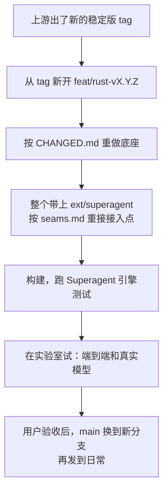

# Codext

Codext 是 [openai/codex](https://github.com/openai/codex) 的一个分支，主打 **Superagent Router**：一个常驻会话替你看着本机所有 Codex 会话，按你的意思推进其中的会话。

当前基于上游稳定版 `rust-v0.167.0`。这是个人项目，按作者自己的使用习惯维护。

## Router：替你看着所有会话

- **看**：Router 不加载会话就能读本机所有会话，知道哪些在做事、哪些在等你（报错、等批准、等回答）。
- **先问清楚再动手**：你说一件事，它先问清楚要做到什么样、在哪里做，用一句话复述打算，你同意才开始。需要时它会新建项目文件夹和会话。
- **推进**：被推进的会话每做完一步，结论以一张 `[通知]` 卡片回到 Router。Router 要么转告你，要么接着回 worker 一句话。引擎会核对这句话：它接着哪句结论说、为了你原话里的哪一点，都要能在记录里找到；有方法名、skill 名或编号这类行话就退回。
- **纠偏**：你发现方向错了，worker 还在做，话会直接插进它正在做的那一步；做错了就打断。
- **换号**：一步因为额度用完或模型满载（"Selected model is at capacity"）失败时，那个账号先冷却，工作换到额度重置最早的账号上重来。顺序和 `codex-account-next list` 一样，跳过免费账号和额度快用完的账号。Router 自己的回合也一样。
- **完全访问**：推进的步骤不加沙箱、不问批准，可以用本机软件和浏览器。
- **长期记住的事**：写进 `~/.codex/AGENTS.md`。每个会话（包括 Router）每走一步都会重读它，改了下一回合就生效，适合记仓库位置、项目文件夹规则、账号习惯这类事。

推进分两档：一句话就能说清的事，在一个文件夹里做，由你验收；多阶段的工程项目，用项目的 `.engineering` 锚定目标，每一步都判定是否可交付、是否偏离、有没有进展。

## Codext 底座

这些是 Router 之外的改动，完整清单见 [CHANGED.md](CHANGED.md)：

- **账号池**：`/profile` 切换当前对话用的账号，历史和设置保留，其他对话不受影响；`codex-account-next <账号>` 用指定账号开会话，`codex-account-next list` 按额度重置时间列出全部账号。
- **状态栏**：模型和推理强度、当前目录、git 状态、额度剩余和重置时间、账号。
- **额度用完时**：排队的消息先停住不发；额度恢复或换号后自动接着做。模型满载时按 15 秒到 240 秒逐步退避，重试原来那一轮。
- **小功能**：`Ctrl+Shift+C` 复制输入框草稿；在 `/resume` 列表里按 `Ctrl+R` 给会话改名。

## 安装和使用

需要 Rust 1.95.0。

从源码运行：

```sh
cd codex-rs
cargo run --bin codex
```

装成本机日常使用的 `codext` 和 app-server daemon，用 `scripts/superagent/promote.sh`：

```sh
scripts/superagent/promote.sh build   # 构建当前提交的完整包
scripts/superagent/promote.sh daily   # 更新日常 daemon 和 ~/.local/bin 里的 codex、codext（会重启 daemon）
```

这个脚本按作者本机的目录写成：构建产物默认放在实验室目录 `~/242-superagent-codext-lab/build`。换一台机器用时，先设 `CODEXT_LAB` 和 `CODEXT_BUILD_DIR`。npm 上的 `@loongphy/codext` 是 Loongphy 的版本，不含 Router。

打开 Router：

1. 在 `~/.codex/config.toml` 里打开功能：

   ```toml
   [features]
   superagent = true
   ```

2. 往 `~/.codex/superagent/router-mode` 里写 `drive`。
3. 运行 `python3 -I scripts/superagent/router.py create` 建 Router 会话，再运行 `python3 -I scripts/superagent/router.py pin` 把它放到 `/agents` 第一行。
4. 打开 `codext`（或 `codex-account-next <账号>`），输入 `/agents`，第一行就是 Router。

自动换号需要 `~/.local/bin/codex-account-status`，由 `scripts/install-codex-account-tools.py` 安装。

## 文档

| 文档 | 内容 |
| --- | --- |
| [docs/superagent/README.md](docs/superagent/README.md) | Router 现在能做什么、怎么开、代码在哪、怎么测试 |
| [docs/superagent/seams.md](docs/superagent/seams.md) | Superagent 在 codex 里的每一个接入点，升级上游时逐个重接 |
| [docs/superagent/updating.md](docs/superagent/updating.md) | 更新计划：跟上游升级、更新 Superagent、发到日常 |
| [CHANGED.md](CHANGED.md) | 相对上游的全部改动，升级时照着保留 |
| [docs/reapply-0.167.0.md](docs/reapply-0.167.0.md) | 这一版在 `rust-v0.167.0` 上重做的记录 |
| [AGENTS.md](AGENTS.md) | 给在这个仓库里干活的 agent 看的规则 |

## 怎么跟着上游更新

`main` 始终等于上游最新稳定版，加上 Codext 底座，再加上 Superagent。上游的代码不合并进来，每次都从上游的 `rust-vX.Y.Z` tag 新开分支，把我们的改动重新做一遍：



- 什么时候更新由用户决定：用户在 Router 里说要更新，Router 就派一个会话按 [updating.md](docs/superagent/updating.md) 去做，做完停下来等验收。
- 重做底座用 `.agents/skills/codex-upstream-reapply` 这个 skill。
- 发布流水线 `rust-release.yml` 只能手动触发，推送 `main` 不会自动构建。

## 致谢

- [openai/codex](https://github.com/openai/codex)：上游。
- [Loongphy/codext](https://github.com/Loongphy/codext)：底座的状态栏、额度队列、auth 重载等功能最早来自这里，本仓库最初也是从它分出来的。
- 状态栏设计参考：<https://linux.do/t/topic/1481797>
