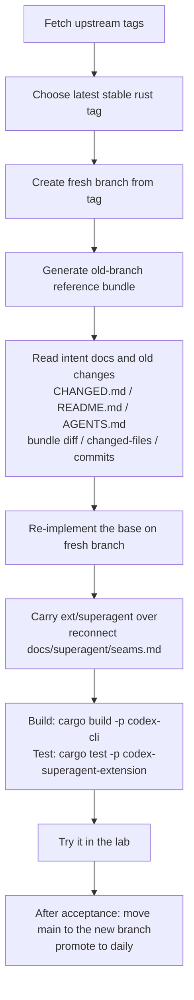

# Codext

An opinionated Codex CLI. This is strictly a personal hobby project, forked from openai/codex. Its main feature is the Superagent Router: one session that watches every session on the machine and drives the ones you hand it.


## Quick Start

Build from source:

```shell
cd codex-rs
cargo run --bin codex
```

To install a local build as the daily `codext` and app-server daemon, use `scripts/superagent/promote.sh` (see [docs/superagent/updating.md](docs/superagent/updating.md)). The `@loongphy/codext` npm package is Loongphy's build and does not include the Router.

## Features

> Full change log: see [CHANGED.md](./CHANGED.md).

---

### Superagent Router

A Router session watches every session on the machine and drives the ones you hand it:

* **Asks first**: it asks what you want, says in one sentence how it will go about it, and starts only when you agree. It can open a new folder and session for the work.
* **Conclusions come back**: when a driven session finishes a step, its conclusion reaches the Router as a short notice card. The Router relays it to you or answers the session itself. The engine checks that each answer quotes what it builds on and the request it serves, and refuses jargon.
* **Corrections land at once**: a correction is steered into the running step, or the step is interrupted when it is going the wrong way.
* **Account switching**: when a step, or the Router itself, hits a usage limit or "Selected model is at capacity", that account cools down and the work moves to the account whose quota resets soonest, in `codex-account-next list` order.
* **Full access**: driven steps run without a sandbox or approvals, so they can use apps and browsers.

Enable it with `[features] superagent = true` in `~/.codex/config.toml`, write `drive` to `~/.codex/superagent/router-mode`, and create the Router with `python3 -I scripts/superagent/router.py create`. Then open `/agents`: the Router is the first row. Details: [docs/superagent/README.md](docs/superagent/README.md).

### TUI: Status Header

The TUI header provides a compact overview of the active session:
- **Context**: Displays the active model, effort level, and current working directory (`cwd`).
- **Git Status**: Background-polled summary of the repository state for the session `cwd`.
- **Rate Limits**: ChatGPT usage-limit snapshots that refresh while the UI is idle.
- **Account Info**: Email + Plan, API Key


### Copy to Clipboard

* **`Ctrl+Shift+C`**: Copies the current draft to the system clipboard.
* **`Ctrl+C`**: Retains existing behavior; remains backward-compatible with legacy logic when the draft is empty.

### Rename Sessions in the Picker

* **`Ctrl+R`** in `codext resume` (the `/resume` picker): Opens a blank inline editor to give the highlighted session a new name.
* **`Enter`**: Saves the name and updates the picker in place.
* **`Esc`**: Cancels the rename and returns to search mode.

### Prompt Queue on usage limit


This feature helps manage follow-up messages when quota or rate limits are reached:

* **Paused and Waiting**: Queued messages wait instead of being sent into more failed turns.
* **Append While Limited**: Even while autosend is paused, you can still press `Tab` to add messages to the queue.
* **Resume on Availability**: Once a later rate-limit snapshot shows quota is available again, Codext sends the **first** queued message.

### Account Switching


Use `/profile <name>` (or `/profile` to open the picker) to change the account
used by the current conversation. Finish or interrupt active work first. The
conversation keeps its history and settings, remembers the selected profile
across restarts, and leaves other conversations' accounts unchanged. A successful
switch releases any recovery prompt parked after a usage-limit error. Upgrade
both the CLI and app-server before using this behavior.

Codex now reloads authentication after external `auth.json` writes settle, so account changes can be picked up without restarting at safe boundaries.

* **TUI**: Polls metadata for the selected profile’s `auth.json` (or the default account file) every 200 ms, with a trailing debounce, without scanning the whole `CODEX_HOME` directory. Auth is deferred until any active task completes; transient read errors do not clear cached auth.
* **App-server**: Reloads auth before `thread/start`, `thread/resume`, and `turn/start` when no turn is running, so the new account is picked up at the next safe request boundary.

This enables auth refresh for TUI and Codex App flows when external tools update `auth.json`.

It also supports Codex App account switching via [codex-auth#103](https://github.com/Loongphy/codex-auth/pull/103).

### Automatic Resumption

After a turn stops on `UsageLimitExceeded`, the TUI can park a recovery prompt and dispatch it after a later `auth.json` reload changes account identity.

You can configure this behavior using `[tui].usage_limit_resume_prompt`:

* **Custom Prompt**: Define a specific string to be sent as the "resumption turn." This prompt will be used to signal the model to continue where it left off.
* **Disable**: Set to `""` (empty string) to disable this automatic recovery behavior entirely.
* **Default**: If left unset, the system uses the following built-in prompt:

  ```text
  The usage limit has been reset, so you can resume from where you left off.
  ```

  Example:

  ```toml
  [tui]
  usage_limit_resume_prompt = ""
  ```

### Server Overload Auto-Resume When `Selected model is at capacity`

When the selected model is overloaded, Codext retries the original turn with bounded exponential backoff (15s → 30s → 60s → 120s → 240s, up to the provider's stream retry limit). This preserves the original prompt and does not add a synthetic `Continue` message to the thread.

```toml
[tui]
server_overloaded_resume = false   # default true; set false to disable
```

## Project Goals

`main` is the latest upstream stable release, plus the Codext base ([CHANGED.md](./CHANGED.md)), plus Superagent. We will never merge code from the upstream repo; instead, we re-implement our changes on top of the latest upstream code. Each bump starts from the openai/codex tag; Loongphy/codext is only a reference.

Iteration flow (aligned with `.agents/skills/codex-upstream-reapply` and [docs/superagent/updating.md](docs/superagent/updating.md)):



## Skills

When syncing to the latest upstream codex version, use `.agents/skills/codex-upstream-reapply` to re-implement our custom requirements on top of the newest code, avoiding merge conflicts from the old branch history.

Example:

```
$codex-upstream-reapply old_branch feat/rust-v0.130.0, new origin tag: rust-v0.131.0
```

## Credits

Status bar design reference: <https://linux.do/t/topic/1481797>
