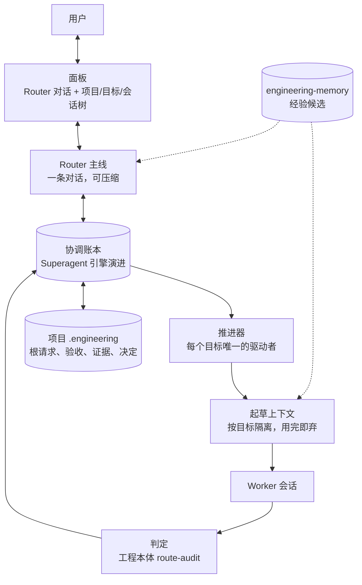
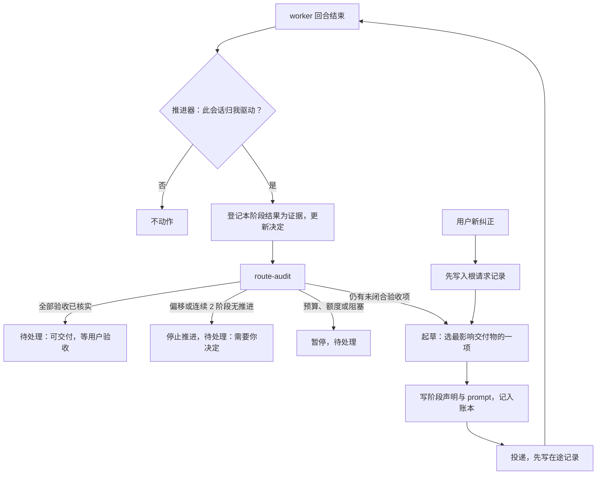

# 总 Router 架构梳理：Superagent 的思想如何复用

版本：讨论稿 v0.1，2026-11-04。状态：**架构候选，供用户讨论和专家评审；没有实施。**

配套材料：[评审主文档](superagent-command-center-review.md)、[接手调研补充](superagent-command-center-research.md)。代码路径默认相对 `codex-rs/`。

## 0. 一句话

总 Router 由四部分拼成：

- **Superagent 的协调账本**：负责归属、投递、回执与恢复；
- **工程本体的目标锚定与判定**：负责根请求、验收清单、偏移检测与可交付判定；
- **Codext 的会话能力**：线程、队列、压缩、账号、项目登记；
- **新增的推进器和起草器**。

它取代两件事：ralph-loop 反复发"好的，继续"，以及用户亲手当监工（开一条会话看着另一条、写 prompt、再搬过去）。

## 1. 用户已确认的方向

| 编号 | 方向 | 来源 |
| --- | --- | --- |
| A01 | 所有项目共用一个总 Router，跨项目分派 | 评审主文档 R01 |
| A02 | Router 管所有会话，但必须能 compact，否则记忆有限 | 2026-11-04 讨论 |
| A03 | 推进方式类似 Goal，由工程本体判断是否达到最终目标 | 2026-11-04 讨论 |
| A04 | ralph-loop 之后由 Router 取代 | 2026-11-04 讨论 |
| A05 | 不是发"继续"，而是由 Router 按工程本体的要求自己撰写每一步的 prompt 来推进 | 2026-11-04 讨论 |
| A06 | 先把整个架构梳理清楚，弄明白 Superagent 的思想如何复用，再定实施顺序 | 2026-11-04 讨论 |

使用数据为这些方向提供了依据（见调研补充 §1）：

- "继续"类消息约 2300 条，占用户消息的 45%；
- 用户常开一条会话监督另一条，并请它"给我 prompt，让他继续"；
- 每天活跃会话的中位数是 11 个，分布在 7 个项目。

## 2. 现有五种机制各自解决了什么

| 机制 | 已解决 | 缺什么 |
| --- | --- | --- |
| ralph-loop | 让会话持续推进 | 完成靠模型输出"暗号"；每条会话各推各的，没有全局视图；与 Goal、队列抢着发 |
| Codext Goal | 目标持久化，每次续跑重新注入，不怕压缩；有预算；续跑提示含"无进展检查"和"完成审计" | 完成由模型自己调用 `update_goal(complete)` 宣布，外部无法验证（`ext/goal/src/tool.rs:247-318`）；不区分空闲原因，一空闲就续跑；历史上因与执行器争抢生命周期被否决 |
| Superagent 引擎 | 单写者账本、事务内投递、在途记录、开头点名直达、退回、预算、容量续跑守卫、并发槽位、先对账后分发 | 一项目一 PM；只管自己创建的 worker；必须 git worktree；ready 即完成，没有验收态；没有记忆对象；几处缺陷（调研补充 G01–G03） |
| 工程本体 | 根请求逐字保存；验收清单；阶段声明；"继续"的语义（推进未闭合的验收项）；偏移判据；`route-audit` 给出可交付范围；organization 的"必要命题未支持不能完成"；压缩后从项目目录恢复 | 不派发模型，不调度；没有跨项目注册表；每阶段要准备带 sha256 的记录，仪式成本高；当前为 rc.7"重构中" |
| engineering-memory | 跨会话经验、来源追溯、纠正链、使用反馈 | 不是当前事实的正本；召回只是待核候选 |

五者互补：ralph-loop 和 Goal 提供"不停推进"，Superagent 提供"可靠协调"，工程本体提供"推进到哪、算不算完成"，engineering-memory 提供"以前学到什么"。总 Router 要做的是把它们接成一个整体，而且同一件事只让一个机制负责。

## 3. 架构总图

| 组件 | 职责 | 由什么演进而来 |
| --- | --- | --- |
| 面板 | Router 对话常驻；按项目 → 目标 → 会话展示；业务状态与运行状态分开；查看、纠正、暂停、接管、交回 | 现有 Agent command center |
| Router 主线 | 与用户对话：理解要求、建立或修改目标、汇报异常、请用户决定。不参与每一次推进 | Superagent PM 的入口角色 |
| 协调账本 | 唯一写者。记录会话的驱动权、目标引用、每次推进（prompt、依据、回执、回合、结果）、用户纠正、待处理事项 | `ext/superagent` 的 store、effects、outbox |
| 推进器 | 每个目标只有一个驱动者。worker 回合结束后触发判定，决定是起草下一步、暂停，还是上报 | Superagent 执行器加 Goal 续跑的思想 |
| 起草上下文 | 按目标单独开启，只读这一个目标的锚定记录、最近一次审计、worker 最近的结果，写出下一阶段的声明和 prompt；写完即弃 | 新增；把用户手动"请给我 prompt"自动化 |
| 判定 | 登记本阶段结果为证据，更新决定，运行 `route-audit`，得到可交付、未闭合、偏移或不一致 | 工程本体 |
| 项目 `.engineering` | 根请求、纠正、验收清单、证据与决定的正本 | 工程本体 |
| engineering-memory | 起草和 Router 对话时提供经验候选，只作参考 | 现有模块 |

## 4. 每类信息只有一个正本

工程本体内部已经有两套目标记录（route-anchor 和 organization.goal）。如果 Superagent 账本再存一份目标内容，就会出现三套，所以规定如下：

| 信息 | 正本 | 其他地方只保存 |
| --- | --- | --- |
| 根请求原文、用户纠正、验收清单 | 项目 `.engineering` 的 route-anchor | 账本只存引用（项目根、锚定 id、修订号）和状态缓存 |
| 证据、决定、可交付判定 | 项目 `.engineering` 与 `route-audit` 输出 | 账本存审计结果的指针和摘要 |
| 会话内容 | Codext 线程 | 账本存线程 id 与驱动权 |
| 每次推进的 prompt、依据、投递回执、结果 | 协调账本 | 面板展示 |
| 跨会话经验 | engineering-memory | 起草时作为待核候选注入 |
| 目录 ↔ 项目数据根 ↔ 工程 Project ID ↔ Codext project 的映射 | 新增的项目注册表 | Codext `project/*` 作为面板索引 |

这样，Router 对话和起草上下文都可以随时压缩或丢弃：权威事实都在它们外面。这正是工程本体 goal-anchoring §5 的原则："锚定记录保存在 Project 目录内，不依赖会话记忆。"

## 5. 推进循环：取代 ralph-loop

### 起草器写什么

起草器按 goal-anchoring §2 的阶段格式写每条 prompt：

- 本阶段的对象，以及它与根对象的关系；
- 推进哪一项验收，预期得到什么；
- 如果使用参照案例或外部案例，什么条件下返回根对象；
- 最近一次用户纠正，必须处理；
- 不能做的事情，例如超出工作范围、修改其他项目。

worker 回合结束时，要按同一格式回填结果。

### 何时停止

停止条件由工程本体给出，不再是次数上限或"完成暗号"：

- `route-audit` 报告全部验收项为 `delivery_verified`，Router 汇报"可交付"；最终验收仍由用户做；
- 连续 2 个阶段没有推进任何验收项，或者离开了根对象，判为偏移，停下来问用户；
- 预算用尽、账号额度不足或真实阻塞时暂停。

### 从三种已有机制继承的守卫

- **从 Superagent 容量续跑继承**：推进前核对目标指纹，确认没有新的用户输入、报告或运行中的工作；回执与计数持久化，重启不重置；收到新输入、停止或报告时，取消已排定的推进。
- **从 Goal 继承**：目标每次重新注入，不怕压缩；"无进展"分类；按目标计 token 预算。
- **从 ralph-loop 继承**：机制简单，一个目标一条循环，可随时取消。

## 6. 驱动权：一个会话同一时刻只有一个驱动者

调研补充 F14 列出了六套互不知晓的自动驱动。总 Router 的前提，是每个根会话在任一时刻只有一个登记在案的驱动者：

| 会话类别 | 谁驱动下一回合 | 其他机制如何处理 |
| --- | --- | --- |
| 普通会话（未纳管） | 用户、Goal、队列，与现状相同 | 不变 |
| 由 Router 推进的会话 | 只有推进器 | Goal 关闭或只作展示；队列只作投递通道；daemon 重启续跑先查驱动权；TUI 自动发送不对它生效 |
| 用户接管中的会话 | 用户 | 推进器暂停；交回时重新读取根请求和纠正 |
| 原生 helper（子 agent） | 父会话 | 不变 |

技术上已有落点：

- 扩展注册顺序已经是 queue → superagent → goal（`app-server/src/extensions.rs:91-112`），推进器可以在 Goal 之前处理空闲事件；
- 驱动权标记可以写在线程附件里，可幂等写入，并能按类型反查；
- daemon 快照（`app-server/src/request_processors/daemon_snapshot.rs`）需要改为先查驱动权。

候选形态与取舍：

| 形态 | 做法 | 结论 |
| --- | --- | --- |
| 复用 Goal | Router 给每个 worker 设 Goal，worker 自己续跑，完成后再由工程本体复核，不通过就重新打开 | 不推荐作为主线。完成由模型先行宣布、外部只能事后推翻；空闲即续跑；与历史上否决 Goal 的理由相同 |
| Stop hook | 每次结束时调判定器，不达标就阻止结束并注入下一条 | 不推荐。回合会越拉越长，没有循环上限；hook 按配置层生效，而不是按线程 |
| 扩展 Superagent 引擎 | 引擎在 Goal 之前处理空闲事件，由判定结果决定是否推进；用上下文扩展点注入工作记录；用工具扩展点给 Router 跨线程操作 | **推荐**。复用账本、投递和恢复；同一件事只有一个负责者；需要新代码，但不进 codex-core |

## 7. Router 的记忆：让一个入口管几十个项目而不混

历史反证（调研补充 H01）：一个 PM 交替处理两个话题时，上下文会混在一起。总 Router 用四条规则回应：

1. **Router 主线不参与每次推进。** 例行推进发生在按目标隔离的起草上下文里，只有异常进入 Router 主线：可交付、偏移、阻塞、需要决定、驱动权变化。近 30 天"继续"类推进平均每天约 74 次；在新架构下，这些都留在起草上下文里，不进入 Router 主线。
2. **每轮只注入有界的全局索引。** 内容是每个目标一行（项目、目标、阶段、状态、待处理事项），通过 `ContextContributor` 注入。它在压缩重建初始上下文时会重新生成（`core/src/session/compact.rs:84-99`），所以压缩后不会丢。
3. **细节按需回读。** Router 用工具读取某个项目的锚定记录、推进历史，或某个会话的最近回合。读会话时只用 `thread/read` 和 `thread/turns/list`，不恢复线程，以免"查看"触发执行（调研补充 F13）。
4. **转达必须带项目标签**，并引用来源：哪个目标、哪次审计、哪条纠正。

## 8. "管所有会话"的三个档位

用户要求 Router 管所有会话。建议把"管"分成三档，避免"所有会话都被自动推进"：

| 档位 | 含义 | 进入条件 |
| --- | --- | --- |
| 看见 | 所有会话进入索引，Router 能读取并汇报，但不发送任何内容 | 默认，全部会话 |
| 跟踪 | 会话关联到某个项目和目标，Router 汇报进展，用户问"那件事怎么样了"时能答 | 显式关联，或由会话 ID 引用自动生成候选、用户确认 |
| 推进 | 推进器是唯一驱动者，按第 5 节循环自动推进 | 必须有工程本体锚定记录和驱动权登记 |

用户已有的习惯可以直接用作关联依据：把会话 ID 写在第一行、粘贴 status 框、"他正在完成……"这类监督语句（调研补充 U07、U11）。

## 9. Superagent 思想复用对照

| # | 思想 | 原实现 | 在新架构中的位置 | 复用方式 |
| --- | --- | --- | --- | --- |
| 1 | 单写者账本，状态与动作同事务落库，提交后执行 | `ext/superagent/src/core/engine.rs`、`effects.rs` | 协调账本 | 直接复用代码 |
| 2 | 在途记录先写后发，结果不明不盲目重放 | `executor/codext_thread.rs` | 推进器投递 | 复用；补上撤销已入队消息（G02） |
| 3 | 开头点名直达；相似不等于指向；只认显式引用 | `core/thread_rules.rs` | 输入归属 | 复用；把会话 ID、项目名纳入点名；修 t1000 显示名问题（G03） |
| 4 | 工单与讨论串多对多订阅 | `core/intake.rs` | 目标与会话的关联 | 复用思想，改为目标 ↔ 会话 |
| 5 | 人可以直接对 worker 说话，PM 收到通知 | 历史决定 #9 | 用户在 worker 里的纠正记入目标，下次起草必须处理 | 先修 G01，再复用 |
| 6 | 退回超范围要求 | `core/evals.rs` | worker 发现超出目标范围时退回 Router | 直接复用 |
| 7 | 按指派计 token 预算，不用 Goal 预算 | 执行器 | 按目标、按阶段计预算 | 复用；理由仍然成立，避免两个驱动者 |
| 8 | 容量续跑守卫：失败回合、指纹、回执、计数、取消条件 | `executor/codext_thread/capacity.rs` | 推进器的通用守卫 | 复用并泛化到每次推进 |
| 9 | 并发槽位：全局、每 PM、人工消息多占一个 | `executor/slots.rs` | 全局、每项目、每账号 | 重写参数；现有上限远低于实际用量（U02） |
| 10 | 报告五态，ready 必须附证据，有新输入时降级 | worker 工具 | worker 的阶段回填交给判定 | 复用；ready 不再直接结束工单（F20） |
| 11 | 巡检：健康不等于进展，另用账号，按退出码行动 | 外部巡检 | 停滞检测，加上 `route-audit` 的偏移判据 | 复用思想 |
| 12 | 卡片限长，`superagent_read` 分页回读 | `cards.rs`、`resources.rs` | Router 的有界索引与按需回读 | 复用；补数据库层分页和按项目筛选（F11） |
| 13 | PM 不读代码、不扩写需求、不自己规划 | 角色提示 | Router 主线保持此边界；起草器可以写具体 prompt，但范围受验收清单约束 | 部分复用 |
| 14 | 组织线程关闭 memories，以免跨工单串味 | 配置 | 用按项目隔离的记录和 engineering-memory 的显式项目绑定代替 | 复用思想 |
| 15 | 一项目一 PM | `pm-threads` | 由"一个 Router 主线 + 按目标隔离的起草上下文"取代 | 放弃实现，保留其理由作为约束 |
| 16 | 每张工单一个 git worktree | 执行器 | 可选执行方式；默认在项目目录里推进已有会话 | 降级为选项 |
| 17 | 状态聚合与领域事件总线 | `status.rs`、`core/engine.rs` | 面板的数据源 | 复用；事件总线补上订阅者 |
| 18 | 先对账后分发；停机先停调度，再等在途投递 | `lib.rs` | 统一 daemon 的启动和停机顺序 | 复用，并扩展到所有自动驱动（F14） |
| 19 | Dell 部署、ATM、固定账号列表 | 旧部署 | 无 | 放弃 |

## 10. 必须新建的部分

1. **驱动权登记**：Goal、队列、daemon 重启续跑和 TUI 自动发送，都要在发送前查询驱动权。
2. **推进器与起草器**：包括起草上下文的输入边界、阶段声明格式和 prompt 记账。
3. **判定适配**：把 worker 的阶段结果登记为工程本体证据（工具结果或 organization finding），然后运行 `route-audit`。
4. **项目注册表**：目录、项目数据根、工程 Project ID 与 Codext project 的对应；支持新建 `~/编号-名称` 并初始化锚定记录。
5. **Router 的上下文注入与异常合并**：有界索引、待处理事项、按需回读工具。
6. **面板**：
   - Router 对话常驻；
   - 项目 → 目标 → 会话树；
   - 每个目标显示验收进度（已闭合/未闭合/阻塞）和推进状态（推进中、等你、偏移、可交付、已验收）；
   - 查看采用只读方式；
   - 已发送的 prompt 及其依据可追溯。
7. **非 Git 项目的执行**：在项目目录里推进，不强制 worktree。
8. **修复现有缺陷**：G01（worker 内输入不入账）、G02（结果不明的投递仍可能执行）、G03（第 1000 张工单起显示名失效）。

## 11. 风险与前置条件

- **判定的可信度。** 工程本体的程序只核结构、来源和绑定；"决定成立"实际上是宿主（这里是 Router）的断言，同源模型互相复核并不增加独立证据。因此"可交付"不等于"已验收"，最终验收由用户做。
- **成本。** 每次推进都包含一次起草模型调用和一次 worker 回合，而"好的，继续"本身不需要模型。需要按目标设预算，并评估起草用什么模型。
- **仪式开销与覆盖面。** 目前约 10 个项目有 `.engineering`。没有锚定记录的会话只能"看见"或"跟踪"，不能"推进"。Router 可以协助建立锚定，但要先确认验收清单。
- **工程本体的现状。** rc.7 仍在重构；MCP 配置指向已改名的旧目录，因而启动失败；Codex 侧 hook 指向不存在的文件；各项目混用两个安装根；单次提交的 256 个引用上限已经被撞到过。这些需要在实施前理顺。
- **权限与验证。** 调研补充中的 D13（权限与隔离）和 D15（实施阶段的验证规则）仍然阻塞实施。
- **与 ralph-loop 并存。** 同一个会话不能同时由 ralph-loop 和推进器驱动；过渡期需要明确的切换方式。

## 12. 待用户确认的问题

1. 起草出的 prompt 默认直接发送，只有偏移、需要决定或涉及外部影响的才先给用户看——是否同意？
2. 没有 `.engineering` 的项目，Router 是否可以在用户确认验收清单后自动建立锚定记录？
3. 起草器用哪种模型、按什么预算？例如每个目标每天的 token 上限。
4. 第 8 节的三档划分是否符合"管所有会话"的本意？
