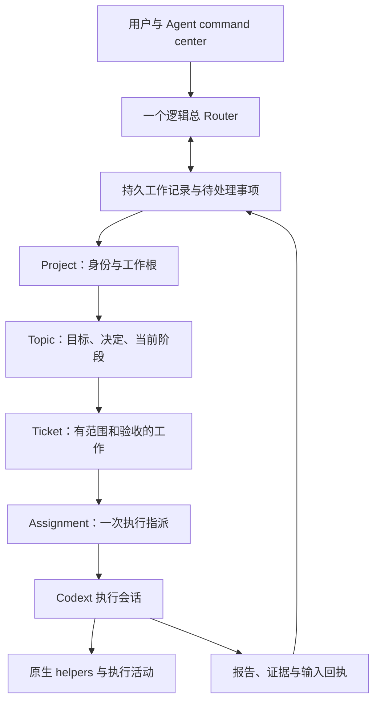

# Mac Agent command center × Superagent：需求与架构评审材料

版本：v0.2，2026-11-04。状态：**待专家评审，仅记录需求、调研、候选设计与验收建议；没有实施本方案。**

v0.2 增加[接手调研补充](superagent-command-center-research.md)：使用量化（U01–U10）、已核实的现有缺陷（G01–G10）、对 F01–F11 的修正、新增事实 F12–F24、历史教训 H01–H12，以及新增决策项 D13–D15。补充文档的结论摘要优先于本文中与之冲突的表述。随后与用户讨论形成的[架构梳理讨论稿](superagent-command-center-architecture.md)记录了新确认的方向（A01–A06）和候选架构。另外，日常 CLI 与 daemon 已更新到包含 `e49ad1451c` 的构建，下文的 `caa8a6c684` 是 v0.1 时的状态。

源码核对基线：`503471d74e1469c08c6aa9620402069c617034a6`。其中组织引擎的 0.166 移植为 `c2fd5a6e7c3e95fce0fcef2724dfd3ac77e0b895`。日常 Mac 安装版仍为 `caa8a6c684`；源码能力、候选运行检查与已安装能力必须分别判断。先前迁移的范围见 [0.166 整合记录](superagent-0.166-integration.md)。

本文提供可共享的技术材料，真实项目目录、会话 UUID、用户反馈原文对照和筛选后的 daemon 记录保存在本地 `~/233-super-agent/plan/design/t06-mac-command-center-review.md` 及其证据附件。仓库不保存原始会话转储、账号标识或凭据。例外：引擎源码沿用 build-27 的部署默认值，其中写有两个旧部署的账号 profile 名（见补充文档 G08）。

## 1. 要解决的问题

用户已把 Codext 用作跨项目、持续多日的工作台：一个会话的目标会演进，一项工作会跨会话和目录接续，同一话题可能由多个 worker 并行推进。现在，用户经常需要自己记住会话 UUID、前后关系、最新决定和谁正在执行。

目标是把 Superagent 的协调能力接入 Mac 的 Agent command center：用户通常从一个总 Router 入口交谈，同时能够从面板查看具体 worker、修正工作并进行人工接管。面板和 Router 应读取同一套项目、话题、任务与执行记录。

这是项目身份、消息归属、任务生命周期、持久记忆、人工控制及迁移的一次系统设计。加一个输入框、展示全部聊天摘要或移除 daemon 的功能限制，都不足以完成目标。

## 2. 已确认的用户要求和本轮边界

下表是用户方向，不能把后文的候选实现自动视为已批准。

| 编号 | 已确认要求 | 对方案的约束 |
| --- | --- | --- |
| R01 | 所有项目共用一个总 Router，由它跨项目分派 | 一个日常协调入口；不要求用户维护每项目一个 PM |
| R02 | 优先转向 Mac，整合到当前系统 | 以当前 Codext 面板、daemon、账号和会话体系为整合目标；部署细节待评审 |
| R03 | 支持新建 `~/编号-名称` 项目，先尊重现有习惯 | 支持中文、非 Git 根目录、嵌套仓库和已有项目；不能套用固定仓库模板 |
| R04 | 能识别正在谈哪个 session/task 的进展 | 保留当前讨论对象、跨会话接续和历史引用；归属不明确时不盲目派工 |
| R05 | 一个话题可以有多个 worker 并行 | 话题、工单、执行会话不能简单等同；要明确分工、依赖与汇总责任 |
| R06 | 用户可从面板进入 worker 查看和人为修正 | 区分查看、发消息、接管和交回；接管后协调器必须知道最新决定 |
| R07 | 随任务增多，总 Router 仍能接续工作 | 外部持久记录、按需取回、有限上下文；不能依赖一条无限增长的对话 |
| R08 | 先记录问题、反馈和调研，组织专家评审 | 本轮只交付文档和证据，不实施新架构、不修改运行中的任务 |
| R09 | 暂时不恢复 ATM | 不恢复 ATM、隧道和封存组织工单；旧恢复说明不是当前执行指令 |

“一个总 Router”描述用户面对的逻辑入口，不预先规定永远使用同一个模型上下文，也不预先批准后台多 Router、自动拆单或新调度器。

## 3. 调研方法与证据边界

### 3.1 本机 daemon

2026-11-04 **19:17:41 America/Los_Angeles** 的列表记录，加上随后完成的只读详情补查：

- 使用本机 Unix socket 的 `thread/list`、`thread/loaded/list`、`thread/read` 和 `thread/turns/list`。
- `thread/list` 读取未归档项，使用 state DB 路径并包含各来源类型；本次返回 46 条，分页已结束。
- 列表状态为 4 条 `active`、1 条 `idle`、41 条 `notLoaded`。
- 已加载列表返回 9 个线程；其中 5 个在上述列表内，另 4 个通过详情补查取得：3 个子 agent 和 1 个无标题根会话。
- 两组结果去重后共观察到 50 个线程。**这不是全部历史线程总数**；归档记录、未列出的历史子线程和其他 CODEX_HOME 不在此次覆盖范围内。
- 在这次合并观察中，已加载线程为 4 个活动、5 个空闲。状态读取不是跨所有 RPC 的事务快照，随后可能变化。
- 只抽查了 6 个相关会话的最近 2 轮；保留的消息正文有长度上限，没有逐字审计全部历史。
- 没有提交模型消息，没有恢复、停止、接管或切换任何账号。

当前已观察记录的 `projectId` 均为空。本机 `projects` 与 `project_roots` 表的只读计数均为 0。该结论仅描述本机此次检查，不表示协议没有项目能力。

### 3.2 项目目录习惯

同日的家目录扫描发现 259 个以两到三位数字加短横线开头的目录，使用 234 个不同编号，最大编号 241。它们包含备份、变体和工作树，**不能直接视作 259 个正式项目**。本地证据附件记录了复核时间与扫描口径。

- 部分编号重复，编号不能作为数据库唯一主键，也不能按目录数量生成下一个编号。
- 只有 28 个目录在根部有 `.git`；项目根和代码仓库根经常不同。
- 一个项目目录可能包含多个仓库；同一外层目录下也可能存在独立业务 Project。
- 中文、英文和混合名称均存在。普通文件、研究资料和工程数据也是项目内容。
- 抽查的 shell 使用记录显示直接 `mkdir`、`cd` 后启动工作；在已检查的配置和启动入口中未发现覆盖这些目录的统一建项目工具。此项不是对所有工具的穷尽证明。
- 工程项目明确要求保留自己的数据所有者、独立子项目及 Git 边界。控制中心的 Project 只能建立映射，不能替代工程对象的权威状态。

因此，默认创建路径可以遵循现有习惯，但编号分配、冲突处理、目录与登记的失败恢复仍需设计。

## 4. 从真实工作中观察到的问题

真实会话对应表在本地附件；这里使用案例编号，避免把私人工作记录加入仓库。

| 案例 | 已观察事实 | 评审所需考虑 |
| --- | --- | --- |
| C01 标题与目标漂移 | 当前会话标题仍是 profile 切换修复，实际已进入 Superagent 与面板架构讨论 | 标题与首条消息不能充当当前目标；需要可修订的当前工作说明及来源 |
| C02 多会话接续 | 同一有限元项目有两条近似“询问进展”的会话，都引用同一旧 UUID；一条只有中断提问，另一条最近报告到 S46 | 区分引用、接续、重复入口和真正执行者；S46 是会话报告，本次未复验其工程成果 |
| C03 跨目录归属 | C02 的原始调研会话在家目录，后续工作进入编号项目目录 | cwd 可作为归属线索，但不是完整的项目身份 |
| C04 话题与执行树 | 蚁群会话由搜索项目演进到规模实验，挂有 3 个已加载子 agent | 同时呈现业务话题与执行树；3 个子 agent 在此次观察时空闲，不能写成正在并行执行 |
| C05 状态语义不足 | 大部分列表项为 `notLoaded`；当前列表还有首轮问候、无标题或验证用途的会话 | 运行时状态不能证明业务完成；历史会话不应无差别变成待执行工单 |
| C06 关联不等于同一任务 | 蚁群、工程记忆、Superagent 研究分布于不同目录；工程图纸目录内也有独立子项目 | 允许关联知识，但不能因语义相近或路径嵌套就自动合并任务、执行权限或工程状态 |

用户最直接的负担是手动维护“工作后来在哪里继续、现在谁负责、上次决定是什么”。规模增大既会增加上下文成本，也会放大归属和状态错误。

## 5. 现有实现能复用什么，缺什么

下表核对的是本仓库源码；除明确列出的运行观察外，不代表已在日常 daemon 启用或完成新架构验收。

| 编号 | 已核对能力或限制 | 对本次整合的含义 | 源码 |
| --- | --- | --- | --- |
| F01 | 原生项目协议已有 create/import/list/update；create 走项目存储，未负责创建目录 | 可以复用登记能力；新建目录、登记及失败恢复需要单独合同 | [项目处理器](../codex-rs/app-server/src/request_processors/projects.rs)、[项目协议](../codex-rs/app-server-protocol/src/protocol/v2/project.rs) |
| F02 | 面板项目分组依据仓库身份及相对 cwd，或直接依据 cwd | 尚未表达正式的话题与工单归属 | [分组实现](../codex-rs/tui/src/app/agents_overview_view.rs) |
| F03 | 组织引擎已有持久工单、指派、输入、报告、订阅、effects/outbox 和恢复基础 | 应复用协调机制，保留输入回执、幂等与恢复边界；不要只在 TUI 保存第二份状态 | [领域模型](../codex-rs/ext/superagent/src/core/model.rs)、[输入处理](../codex-rs/ext/superagent/src/core/intake.rs)、[发件箱](../codex-rs/ext/superagent/src/outbox.rs) |
| F04 | 领域 Thread 表示请求/工单消息归属，不等于 Codext 执行线程；worker 输入归自己的工单，PM 开头点名才直接指向工单，其他提及只作为上下文 | 新 UI 的话题、执行会话和消息目标必须分别建模；不能把总 Router 的整段会话订阅给全部工单 | [线程归属规则](../codex-rs/ext/superagent/src/core/thread_rules.rs) |
| F05 | 一个 accept 决策对应一个工单；同一触发的重复 accept 返回先前结果 | 已有多个工单并行基础，但“一个大请求自动拆为多个工单”仍需新合同，不能绕过去重制造子任务 | [路由工具](../codex-rs/ext/superagent/src/tools/pm.rs) |
| F06 | 组织状态按 PM 与项目分组，执行器仍有旧部署的仓库、工作树、分支及账号默认值 | 总 Router 跨项目后，需要将执行项目配置从旧 PM 绑定中解耦；不能直接沿用旧默认部署 | [状态](../codex-rs/ext/superagent/src/status.rs)、[执行器配置](../codex-rs/ext/superagent/src/executor/codext_thread.rs) |
| F07 | managed daemon 与 Superagent 同时启用被明确拒绝，原因是自动续跑与组织恢复不兼容 | 必须先确定每个线程的恢复/续跑所有者；删除拒绝条件不构成整合 | [宿主保护](../codex-rs/app-server/src/lib.rs) |
| F08 | 本次 3 个子 agent 的 `canAcceptDirectInput=false`；原生 v2 子 agent 有对应输入限制 | Superagent 根 worker 与原生 helper 不同；查看可以统一，人工输入与接管需要按能力处理 | [输入所有权](../codex-rs/app-server/src/request_processors/thread_input.rs)、[线程能力](../codex-rs/app-server-protocol/src/protocol/v2/thread_data.rs) |
| F09 | 卡片摘要最多 600 字符、预览 160 字符，相关工单最多 8 张 | 是有限上下文的已有基础；字符限制不是模型 token 上限，也不是整个 Router 历史上限 | [候选卡](../codex-rs/ext/superagent/src/cards.rs) |
| F10 | `superagent_read` 可分页回读；文本默认 4000/最多 8000 字符，列表默认 20/最多 50 项 | 可复用回读入口；参数仍主要是 resource/offset/limit，缺少本方案需要的项目/话题筛选合同 | [读取工具](../codex-rs/ext/superagent/src/tools/read.rs)、[资源读取](../codex-rs/ext/superagent/src/resources.rs) |
| F11 | tickets 资源先读取全部工单并构造卡片再截页；候选渲染也有全工单扫描和计数 | 输出有上限不等于底层查询有上限；需评估索引、数据库分页和规模成本 | [资源读取](../codex-rs/ext/superagent/src/resources.rs)、[候选渲染](../codex-rs/ext/superagent/src/pm.rs)、[存储查询](../codex-rs/ext/superagent/src/store/queries.rs) |

0.166 候选已经完成 Mac/Linux 构建以及隔离的、没有模型回合的启动/重启检查。这些检查不证明 Mac 统一 daemon、真实派工、人工接管或规模化记忆已经成立。11/03 的早期审计也不能直接当作 build-27 或当前源码的缺陷清单。

## 6. 候选设计：供评审，不是已定 API

### 6.1 对象与关系



图表示主要归属，不要求所有关系都是树。一个历史会话可能先后承载多个话题；一个话题也可能关联多个历史会话。跨项目工作可记录参与关系，但每次实际写入或派工仍必须有明确的执行项目和范围。Topic 是否成为正式持久实体，是评审 D01。

Project 使用稳定内部身份；显示编号、路径、仓库、业务工程 Project 的映射分别保存。Topic 保存目标及修订。Ticket 保存范围、交付和验收。Assignment 保存执行者、工作目录、账号/模型绑定和控制状态。原始消息、回执和来源不能被摘要覆盖。

旧会话可先作为关联资料被查询；成为引擎管理的执行者应有显式的纳管记录。发现、导入和纳管不能顺带恢复所有旧任务。

### 6.2 消息与面板焦点

- 输入时明确显示“发给谁”和“关于什么”：总 Router/具体 worker，以及项目、话题、必要时工单。
- 草稿绑定稳定 ID。列表刷新、排序或只浏览另一行，不应悄悄改变草稿目标；切换输入目标是显式动作。
- 回复某条报告时保留来源关联。显式目标与正文提及冲突时呈现冲突，不通过一次语义猜测覆盖目标。
- 已有确定工单归属的跟进可使用现有直通机制；一般进度询问优先读取记录，不因查看进度自动唤醒全部 worker。
- “那个任务继续”等存在多个合理对象的指令，需要选择对象；展示候选、关联原文和当前状态即可，不要求用户记 UUID。
- 同一话题的公共纠正如需通知多个 worker，应生成可追踪的定向投递及回执，避免整段 Router 对话被无差别广播。
- 区分已保存、已投递、已确认、已完成；“发送成功”不能同时代表这些状态。

### 6.3 并行与人工介入

一张工单当前的主 worker 与它的 helpers 是一层执行关系；同一话题下多个工单是另一层。并行执行需记录工作范围、依赖、写入边界、报告汇总者及最终验收者。

总 Router 是否负责拆分大任务、拆分到什么程度、如何限制重复工作与成本，尚需决定。旧 PM 角色以路由为主，不能直接假定它已经提供任意任务分解能力。

人工操作至少区分：查看、追加纠正、暂停、接管、交回。接管需对齐当前回合、排队输入、恢复动作和 helper 归属；主任务应得到对应事件，交回时重新读取最新决定。对于不接受直接输入的 helper，可评审“经主 worker 转达”和“增加明确的控制权转移协议”两种方案；不能仅在 TUI 放开输入框。

### 6.4 Router 的记忆与规模

建议划分四类信息，具体存储与一致性方案见 D06：

| 信息 | 保存什么 | 进入 Router 本轮上下文的方式 |
| --- | --- | --- |
| 原始事实 | 用户原文、纠正、事件、回执、报告、证据引用及版本 | 根据来源 ID 精确回读；不靠多次摘要代替原文 |
| 当前工作记录 | 项目/话题目标、最新决定、执行者、进度、未决问题、暂停约束 | 本轮涉及的话题优先加载；标出来源修订和更新时间 |
| 全局索引与待处理事项 | 可搜索的项目/话题条目、需要用户处理的事件 | 分页、过滤和按需检索；不把所有项目详情塞入每一轮 |
| 临时工作上下文 | 当前问题所需的有限证据与最近对话 | 设置 token 预算；不足时分段回读或重建，不默默丢弃关键约束 |

摘要是可重建的派生资料。状态、授权、停止指令、未处理输入及未确认投递必须有确定的持久记录。摘要过期、与原始来源冲突或证据不足时，应标为需要核对，执行前回读当前记录。

一般进度按话题合并，完成、阻塞、需要人决定及控制权变化进入待处理列表。保留事件顺序、去重键、已处理位置与未读状态；具体合并窗口和优先级待评审。正在讨论的千只蚁群实验，应把实验内的局部决策保留在实验轨迹中，由实验任务汇总，不把每次 API 决策都变成总 Router 的新消息或独立 Codext 工单。

总 Router 可以保持一个逻辑入口，同时压缩或重建模型上下文。重建前后应核对处理位置、待决事项、用户纠正和投递回执，先恢复协调状态再接新动作。检索、摘要和消息合并分别解决访问成本、上下文大小和通知增长；仅增加模型上下文窗口不完成这三件事。

候选评估指标：单轮 Router 输入 token 与总历史量的关系、检索命中与漏检、过期摘要误用、遗漏约束、错投/重复投递、通知等待时间、恢复后重复执行、数据库查询成本。尚未确定目标数值，也没有规模性能结论。

### 6.5 新项目与历史导入

默认建项目时扫描已占用编号并提出下一个可用路径，用户指定编号/名称优先。并发创建要有冲突保护，不能以本次最大编号 241 固化默认值。创建空项目也应能显示在面板中，不要求先生成模型会话或初始化 Git。

目录创建、登记、模板初始化以及失败后的续接需要幂等合同；保留已有文件，恢复前确认实际落地情况。原生 project/create 只是可复用的一部分。

导入旧任务时，显式引用、父子关系、项目登记和目录映射可提供证据。标题相似或语义相近只产生候选关联，不能直接合并执行状态。嵌套独立 Project、多个仓库和验证会话要有不同处理；原始 session UUID 和成果链接继续有效。

### 6.6 同一 daemon 的运行职责

同一进程中仍需明确普通会话、总 Router、组织根 worker 和 helper 的生命周期责任。对每个可执行任务，应能确定谁负责恢复、续跑、停止和清理，并在启动时先对账后分发。

沿用实际账号运行时切换与冷恢复合同；账号变化不能改变工单身份。保存的 profile、实际运行时绑定、模型/provider 和未来可选网关出站账号是不同事实，不应只靠面板标签表示切换已成功。

Mac 统一入口不能依赖恢复 ATM。此次设计也不自动更换日常二进制、迁移凭据、移动旧项目文件或改变 Dell 的封存状态。

## 7. 请专家作出的决策

每项评审需给出结论、依据、被否决方案及验收方式。高层用户方向保持不变；这里讨论实现选择。

| 决策 | 具体问题与候选方向 | 需要的评审输出 |
| --- | --- | --- |
| D01 话题模型 | 独立持久 Topic，还是扩展已有领域 Thread？怎样表示跨会话阶段与一段会话涉及多个话题？ | 实体、关系、修订与旧数据映射；避免混淆原生 thread |
| D02 Router 职责 | 仅路由已明确任务，还是允许受约束拆单？一个请求多工单如何去重、变更和验收？ | 拆单权限、子任务合同、成本边界；保留一个用户入口 |
| D03 输入归属 | UI 焦点、显式引用、正文提及和语义候选如何排序？ | 冲突、歧义、草稿和回复语义；可展示的投递回执 |
| D04 生命周期 | managed daemon 与组织引擎谁拥有各类线程的恢复和自动续跑？ | 所有权表、启动/崩溃/停止时序；证明不会双重续跑 |
| D05 人工接管 | 根 worker 与 parent-owned helper 如何分别控制？ | 状态转换、并发输入仲裁、交回与主任务通知 |
| D06 持久记忆 | 原始记录、当前状态和派生摘要分别由谁维护？沿用哪些库与事件？ | 权威数据来源、版本检查、摘要失效和重建合同 |
| D07 查询与通知 | 数据库筛选/分页、上下文预算、合并、背压和异常优先级如何工作？ | 有界成本方案与量化验证矩阵；用户纠正不可被普通进度挤掉 |
| D08 项目创建 | 稳定身份、编号冲突、非 Git 目录、多根/子项目和部分失败如何处理？ | 创建/导入合同；保留工程系统自己的权威对象 |
| D09 旧任务纳管 | 哪些只索引，哪些纳管？如何识别中断入口、实验验证线程和关联会话？ | 可审阅映射及撤销方案；默认不复活旧工作 |
| D10 面板信息架构 | 项目/话题视图和执行树如何切换？如何显示业务进展与运行状态？ | 有真实案例的交互稿，包括空项目、歧义、纠正、暂停和多 worker |
| D11 资源与账号 | 全局 Router、多项目 worker 的并发、公平性、额度和控制消息如何协调？ | 避免单项目占满资源的策略；实际账号绑定可核验 |
| D12 发布与回退 | API/存储演进、功能开关、日常会话兼容和成套回退如何安排？ | 分阶段范围、退出条件、匹配的二进制/配置/状态备份策略 |
| D13 权限与执行隔离（v0.2） | worker 在 Mac 上以用户身份运行，原先由 Dell 专用用户承担的权限兜底不再存在。沙箱、写入边界、推送与凭据如何限制？ | 权限矩阵，以及与 Dell 专用用户方案的对照 |
| D14 验收质量与巡检（v0.2） | ready 目前直接结束工单。由谁验收？如何检测停滞，呈现"健康不等于进展"？ | 工单验收态、停滞阈值、巡检归属 |
| D15 实施阶段的验证规则（v0.2） | 引擎测试已全部移除，当前分支又禁止新增测试；AGENTS.md 要求界面改动附带 snapshot | 实施分支的检查规则与回归基线 |

建议由熟悉实际使用的产品/交互评审者、Codext daemon 与协议维护者、Superagent 协调引擎维护者、存储/恢复及上下文工程评审者共同检查。本文不指定专家人选，不代替他们作出结论，也没有自动发起专家任务。

## 8. 后续验收建议

这些是评审后的场景建议，本轮没有新增或执行测试。实现阶段还需另行确定适用的仓库检查规则；当前重做分支禁止新增/修改测试和快照，不能把这份清单当作绕过该限制的执行指令。

| 场景 | 必须能观察到的结果 |
| --- | --- |
| 标题过时，工作已进入新阶段 | Router 回答当前目标并指出来源；旧标题不触发过时任务 |
| 两条同名会话，只有一条在推进 | 正确识别执行者，另一条保留原始历史；不重复派工 |
| 先在家目录调研，后建项目 | 保留历史关联和成果链接；不靠搬动原会话完成归属 |
| 一个话题多个工单和 helpers | 明确范围、依赖与汇总；查询进展不广播执行命令 |
| 查看另一行时仍有未发送草稿 | 目标不随排序或浏览悄悄变化 |
| 人工纠正与自动重试同时发生 | 纠正可追踪，过期重试撤销；所有者状态一致 |
| helper 不支持直接输入 | 面板显示真实能力，提供合法转达或接管路径 |
| Router 压缩/重建时收到新消息 | 原文、停止约束、待决问题和回执保留；不丢单、不重复执行 |
| 大量历史任务与高频进度 | 每轮读取和通知有界；关键异常不会长期排在进度后面 |
| 摘要过期或引用来源改变 | 可发现并回读当前来源；不把旧授权当成新授权 |
| 非 Git 空项目、重复编号、创建中途失败 | 路径符合习惯，失败可续接，不覆盖已有文件或重复登记 |
| 旧会话导入与纳管撤销 | ID 与交付链接保留，不自动恢复历史任务 |
| 进程在投递前后崩溃 | 根据回执对账，结果不明先核实，避免盲目重发 |
| 切账号后继续同一任务 | 身份和历史不丢，实际运行时绑定可核验 |
| 功能关闭及回退 | 日常会话行为可用；恢复匹配的配置和状态，ATM 保持原决定 |

阶段建议是：先通过需求和职责评审，再确定数据/API 合同，之后做隔离的只读视图与模拟恢复验证，最后才安排明确范围的真实派工和发布。此顺序是供评审的实施建议，不是当前实施授权或工期承诺。

## 9. 评审记录模板

每条意见请使用以下格式，便于讨论后修订，避免反馈只留在聊天中：

```text
意见编号：RV-___
评审人 / 专长 / 日期：
关联需求、案例、事实或决策：R__ / C__ / F__ / D__
问题或反例：
证据 / 可复现路径：
建议与取舍：
影响范围：
验收方式：
结论：待讨论 / 接受 / 修订后接受 / 不接受
决策人、日期及后续文档修订：
```

本版尚无专家结论。后续修改应保留决定的来源与被替代关系；旧规划中“每项目一个 PM”“协调常驻 Dell”“恢复 ATM 后继续”等内容是历史路线，不应覆盖本轮已确认的用户方向。
